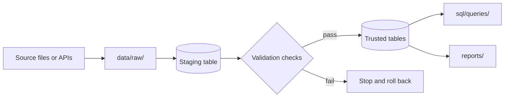
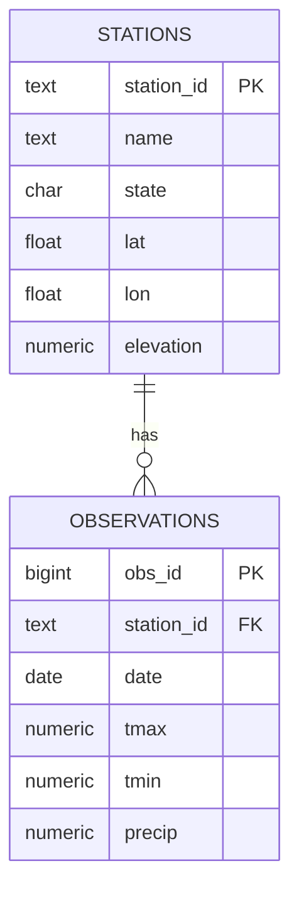

# Technical specification: [system name]

> **What goes here:** the design of your system, in the format professional data teams
> use for a technical specification. Fill in every section. Repeat the table, program, and
> query sections once for each table, program, and client query. The examples come from
> the shared course weather data; replace them, and delete these notes before you tag
> `handoff`. Keep this document in step with `sql/schema.sql` and `src/`.

## Document header

| | |
|---|---|
| **Document name** | TS_[team]_[system], e.g. TS_dasher_storm-exposure |
| **Authors** | |
| **Created on** | |
| **Repository** | [GitHub link] |
| **Knowledge transfer log** | [`docs/kt-log.md`](kt-log.md) |

## Sign-offs

| Role | Name | Date |
|---|---|---|
| Builders (development) | | |
| Receivers (taking ownership) | | |

## Revision history

| Author | Reason for revision | Version | Date | Git tag or commit |
|---|---|---|---|---|
| | Initial authoring | 1.0 | | `handoff` |
| | | | | |

## Objects list

> Every file a receiver needs to run or change the system.

| Object | Type | Description |
|---|---|---|
| `sql/schema.sql` | SQL script | Creates every table, key, and constraint |
| `src/refresh.py` | Program | Inbound interface: pulls new data and appends it safely |
| `src/report.py` | Program | Client report that takes parameters |
| `sql/queries/` | Queries | Client query library |
| `sql/tests/` | Tests | Checks that return zero rows when the data and queries are right |
| `reports/report.qmd` | Report | Part II report and visualizations |

## High-level technical overview

> One paragraph: what the system does for the client, and how. Then your **scope**, one
> of your most important design decisions: which sources, which region, how many years,
> what's out of scope, and why.

*(example)* The system loads daily station weather for Pennsylvania and serves queries on
rainfall and temperature extremes. **Scope:** GHCN-Daily stations in Pennsylvania, 2025
to the present. Out of scope: other states (not needed for the client's question) and
snowfall (too often missing in this extract).

## Process flow diagram

> How data move from the sources to the client. Replace the example with your own; Mermaid
> diagrams like this one display on GitHub.

## ER diagram

> Every table, its primary and foreign keys, and how the tables relate. Once your tables
> exist, compare it with VS Code's **Visualize Schema** on your team's schema: every line
> here should match a foreign key there.

## Assumptions

- *(example)* The GHCN-Daily yearly files are reachable from the course server.
- *(example)* A station with no observation row on a date is treated as not reporting,
  not as a dry day.

## Dependencies

> Every source the system loads, plus anything else it needs to run.

| Source | Where it comes from | Access and terms | Updates | Tables it feeds |
|---|---|---|---|---|
| GHCN-Daily (example) | NOAA NCEI, <https://www.ncei.noaa.gov/products/land-based-station/global-historical-climatology-network-daily> | Public; no account needed | Daily, with late corrections | `stations`, `observations` |

- *(example)* Python 3.13 and the packages in `requirements.txt`; the course server `mads_f26`.

## Roles and authorizations

| Role | Who holds it | Can do |
|---|---|---|
| `<team>_write` | The builders until Nov 23, then the receivers | Create and change tables in the team schema |
| `<team>_read` | The builders after Nov 23, and the TA | Read the team schema |

## Design decisions

> Three to five of your main choices, a short paragraph each: the choice, the
> alternative you rejected, and why.

*(example)* **Observations get their own table**, one row per station per date, rather
than one column per measurement type in a "long" table. Most client queries compare
temperature and precipitation on the same day, which a long table would turn into a
self-join. Enforced by `UNIQUE (station_id, date)`.

## Known issues and limitations

> Everything a receiver should know before trusting a result: proxy measures (named as
> proxies), limitations, and unfinished work. Be specific.

- *(example)* The current year is partial; compare it with earlier years only by month,
  and only for complete months.

---

## Database table: `stations` (example)

> One section per table.

| | |
|---|---|
| **Description** | U.S. weather stations from the GHCN-Daily station list |
| **Row unit** | One weather station |
| **Primary key** | `station_id` |
| **Referenced by** | `observations.station_id` |

| Field | Description | Data source | Data type | Key | Units |
|---|---|---|---|---|---|
| `station_id` | GHCN station ID, e.g. `USW00094823` | GHCN station list | TEXT | X | |
| `name` | Station name | GHCN station list | TEXT | | |
| `state` | Two-letter state code; can be missing | GHCN station list | CHAR(2) | | |
| `lat` | Latitude | GHCN station list | DOUBLE PRECISION | | degrees |
| `lon` | Longitude; negative in the U.S. | GHCN station list | DOUBLE PRECISION | | degrees |
| `elevation` | Elevation; missing for some stations | GHCN station list | NUMERIC | | meters |

## Program: `src/refresh.py` (example)

> One section per program.

| | |
|---|---|
| **Description** | Pulls new observations and appends them safely |
| **Type** | Python command (extract, transform, load) |
| **Status** | In production |
| **Parameters** | `--team`, `--start`, `--end` (exclusive), `--dry-run` |
| **Output** | Prints rows staged, inserted, and updated; adds a row to `ingestion_runs` |

**Pseudocode**

1. **Fetch:** read the source rows for the date range.
2. **Stage:** copy them into a temporary staging table.
3. **Validate:** count duplicate station-dates, negative precipitation, `tmax` below
   `tmin`, and unknown stations. If any check fails, stop; the transaction rolls back and
   nothing changes.
4. **Merge:** insert new rows and update changed ones, matched on `(station_id, date)`. An
   identical rerun changes nothing.
5. **Log:** record the counts in `ingestion_runs`.

## Query: `q01-rainy-days-by-station` (example)

> One section per client query.

| | |
|---|---|
| **Client question** | Which Pennsylvania stations reported rain on the most days in September 2025? |
| **Row unit** | One station |
| **Test** | `sql/tests/t01-rainy-days-match.sql` |

| Field | Description | Source |
|---|---|---|
| `station_id` | Station ID | `stations` |
| `name` | Station name | `stations` |
| `rainy_days` | Days with precipitation above 0 | `observations` |
